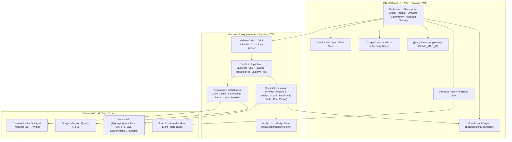

# AirNest System Architecture

## Overview
AirNest is a full-stack TypeScript web application (React + Vite + Tailwind PWA frontend, Express + WebSocket Node.js backend, pure shared Impact Engine, and Firebase/Google Maps/Gemini integrations). All AI keys stay strictly server-side; the frontend communicates exclusively with `/api/*` and `/api/live`.

## System Diagram

## Module Boundaries
- `/packages/shared`: Strict Zod schemas, pure deterministic Impact Engine (`< 1 ms`), Demo Mode scenarios (Coimbatore AQI 85, Delhi AQI 420), and EN/HI/TA i18n dictionary.
- `/server/adapters`: Swappable `AirQualityProvider` interface (`OpenMeteoProvider`, `GoogleMapsAirQualityProvider`) wrapped by `ResilientAirQualityService`.
- `/server/llm/orchestrator.ts`: Single isolated LLM module enforcing system/data separation, read-only function calling, schema-validated plan output, prompt versioning (`2026.11.v1`), and token/cost telemetry.
- `/prompts/systemPrompts.ts`: Versioned prompt templates and injection/medical safety pattern tables.
- `/knowledge/guidance.json`: Grounded CPCB/WHO/EPA/Corsi-Rosenthal reference entries.
